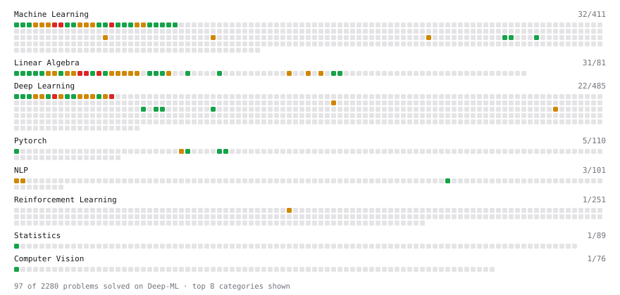

# Deep-ML

My machine learning practice from [Deep-ML](https://www.deep-ml.com). Every solution here was written by hand.

**232** solved · 158 problems · 0 labs · 74 math

[**Browse the interactive portfolio**](https://tanghaibao.github.io/deep-ml/) to replay this filling in over time.

## Problems

| | Difficulty | Solved | |
| --- | --- | --- | --- |
| [Batch Iterator for Dataset](https://www.deep-ml.com/problems/30) | easy | 2024-08-03 | [solution](problems/0030-batch-iterator-for-dataset) |
| [Bhattacharyya Distance Between Two Distributions](https://www.deep-ml.com/problems/120) | easy | 2025-09-03 | [solution](problems/0120-bhattacharyya-distance-between-two-distributions) |
| [Binary Classification with Logistic Regression](https://www.deep-ml.com/problems/104) | easy | 2025-02-08 | [solution](problems/0104-binary-classification-with-logistic-regression) |
| [Calculate 2x2 Matrix Inverse](https://www.deep-ml.com/problems/8) | easy | 2024-08-03 | [solution](problems/0008-calculate-2x2-matrix-inverse) |
| [Calculate Accuracy Score](https://www.deep-ml.com/problems/36) | easy | 2024-08-03 | [solution](problems/0036-calculate-accuracy-score) |
| [Calculate Computational Efficiency of MoE](https://www.deep-ml.com/problems/123) | easy | 2025-09-03 | [solution](problems/0123-calculate-computational-efficiency-of-moe) |
| [Calculate Conditional Probability from Data](https://www.deep-ml.com/problems/168) | easy | 2025-08-27 | [solution](problems/0168-calculate-conditional-probability-from-data) |
| [Calculate Cosine Similarity Between Vectors](https://www.deep-ml.com/problems/76) | easy | 2024-12-06 | [solution](problems/0076-calculate-cosine-similarity-between-vectors) |
| [Calculate Covariance Matrix](https://www.deep-ml.com/problems/10) | easy | 2024-08-03 | [solution](problems/0010-calculate-covariance-matrix) |
| [Calculate Dice Score for Classification](https://www.deep-ml.com/problems/73) | easy | 2024-11-21 | [solution](problems/0073-calculate-dice-score-for-classification) |
| [Calculate F1 Score from Predicted and True Labels](https://www.deep-ml.com/problems/91) | easy | 2025-01-16 | [solution](problems/0091-calculate-f1-score-from-predicted-and-true-labels) |
| [Calculate Image Brightness](https://www.deep-ml.com/problems/70) | easy | 2024-11-14 | [solution](problems/0070-calculate-image-brightness) |
| [Calculate Jaccard Index for Binary Classification](https://www.deep-ml.com/problems/72) | easy | 2024-11-21 | [solution](problems/0072-calculate-jaccard-index-for-binary-classification) |
| [Calculate Mean Absolute Error (MAE)](https://www.deep-ml.com/problems/93) | easy | 2025-01-16 | [solution](problems/0093-calculate-mean-absolute-error-mae) |
| [Calculate Mean by Row or Column](https://www.deep-ml.com/problems/4) | easy | 2024-08-03 | [solution](problems/0004-calculate-mean-by-row-or-column) |
| [Calculate Portfolio Variance](https://www.deep-ml.com/problems/183) | easy | 2025-09-11 | [solution](problems/0183-calculate-portfolio-variance) |
| [Calculate R-squared for Regression Analysis](https://www.deep-ml.com/problems/69) | easy | 2024-11-14 | [solution](problems/0069-calculate-r-squared-for-regression-analysis) |
| [Calculate Root Mean Square Error (RMSE)](https://www.deep-ml.com/problems/71) | easy | 2024-11-14 | [solution](problems/0071-calculate-root-mean-square-error-rmse) |
| [Calculate the Phi Coefficient](https://www.deep-ml.com/problems/95) | easy | 2025-01-27 | [solution](problems/0095-calculate-the-phi-coefficient) |
| [Compute Discounted Return](https://www.deep-ml.com/problems/165) | easy | 2025-08-27 | [solution](problems/0165-compute-discounted-return) |
| [Compute Multi-class Cross-Entropy Loss](https://www.deep-ml.com/problems/134) | easy | 2025-08-30 | [solution](problems/0134-compute-multi-class-cross-entropy-loss) |
| [Compute the Cross Product of Two 3D Vectors](https://www.deep-ml.com/problems/118) | easy | 2025-09-03 | [solution](problems/0118-compute-the-cross-product-of-two-3d-vectors) |
| [Compute TPR and FPR from Classifications](https://www.deep-ml.com/problems/1217) | easy | 2026-09-28 | [solution](problems/1217-compute-tpr-and-fpr-from-classifications) |
| [Convert Vector to Diagonal Matrix](https://www.deep-ml.com/problems/35) | easy | 2024-08-03 | [solution](problems/0035-convert-vector-to-diagonal-matrix) |
| [Create a Float Tensor from a Python List](https://www.deep-ml.com/problems/880) | easy | 2026-09-23 | [solution](problems/0880-create-a-float-tensor-from-a-python-list) |
| [Create and Inspect a Tensor](https://www.deep-ml.com/problems/1220) | easy | 2026-11-09 | [solution](problems/1220-create-and-inspect-a-tensor) |
| [Derivative of a Polynomial](https://www.deep-ml.com/problems/116) | easy | 2025-08-27 | [solution](problems/0116-derivative-of-a-polynomial) |
| [Descriptive Statistics Calculator](https://www.deep-ml.com/problems/78) | easy | 2024-12-21 | [solution](problems/0078-descriptive-statistics-calculator) |
| [Detect Overfitting or Underfitting](https://www.deep-ml.com/problems/86) | easy | 2025-01-08 | [solution](problems/0086-detect-overfitting-or-underfitting) |
| [Dot Product Calculator](https://www.deep-ml.com/problems/83) | easy | 2026-09-20 | [solution](problems/0083-dot-product-calculator) |
| [Dynamic Tanh: Normalization-Free Transformer Activation](https://www.deep-ml.com/problems/128) | easy | 2025-10-04 | [solution](problems/0128-dynamic-tanh-normalization-free-transformer-activation) |
| [Embedding Layer as One-Hot Matrix Multiplication](https://www.deep-ml.com/problems/947) | easy | 2026-10-05 | [solution](problems/0947-embedding-layer-as-one-hot-matrix-multiplication) |
| [Empirical Probability Mass Function (PMF)](https://www.deep-ml.com/problems/184) | easy | 2025-09-19 | [solution](problems/0184-empirical-probability-mass-function-pmf) |
| [Feature Scaling Implementation](https://www.deep-ml.com/problems/16) | easy | 2024-08-04 | [solution](problems/0016-feature-scaling-implementation) |
| [GeLU Activation Function ](https://www.deep-ml.com/problems/147) | easy | 2025-09-03 | [solution](problems/0147-gelu-activation-function) |
| [Generate a Confusion Matrix for Binary Classification](https://www.deep-ml.com/problems/75) | easy | 2024-12-06 | [solution](problems/0075-generate-a-confusion-matrix-for-binary-classification) |
| [Grayscale Image Contrast Calculator](https://www.deep-ml.com/problems/82) | easy | 2025-01-08 | [solution](problems/0082-grayscale-image-contrast-calculator) |
| [Greedy Autoregressive Text Generation](https://www.deep-ml.com/problems/1070) | easy | 2026-10-05 | [solution](problems/1070-greedy-autoregressive-text-generation) |
| [Implement a Simple Residual Block with Shortcut Connection](https://www.deep-ml.com/problems/113) | easy | 2025-08-30 | [solution](problems/0113-implement-a-simple-residual-block-with-shortcut-connection) |
| [Implement Compressed Column Sparse Matrix Format (CSC)](https://www.deep-ml.com/problems/67) | easy | 2024-11-08 | [solution](problems/0067-implement-compressed-column-sparse-matrix-format-csc) |
| [Implement Compressed Row Sparse Matrix (CSR) Format Conversion](https://www.deep-ml.com/problems/65) | easy | 2024-11-02 | [solution](problems/0065-implement-compressed-row-sparse-matrix-csr-format-conversion) |
| [Implement F-Score Calculation for Binary Classification](https://www.deep-ml.com/problems/61) | easy | 2024-10-24 | [solution](problems/0061-implement-f-score-calculation-for-binary-classification) |
| [Implement Gini Impurity Calculation for a Set of Classes](https://www.deep-ml.com/problems/64) | easy | 2024-10-27 | [solution](problems/0064-implement-gini-impurity-calculation-for-a-set-of-classes) |
| [Implement Global Average Pooling](https://www.deep-ml.com/problems/114) | easy | 2025-09-01 | [solution](problems/0114-implement-global-average-pooling) |
| [Implement Orthogonal Projection of a Vector onto a Line](https://www.deep-ml.com/problems/66) | easy | 2024-11-02 | [solution](problems/0066-implement-orthogonal-projection-of-a-vector-onto-a-line) |
| [Implement Precision Metric](https://www.deep-ml.com/problems/46) | easy | 2024-08-26 | [solution](problems/0046-implement-precision-metric) |
| [Implement Recall Metric in Binary Classification](https://www.deep-ml.com/problems/52) | easy | 2024-09-25 | [solution](problems/0052-implement-recall-metric-in-binary-classification) |
| [Implement ReLU Activation Function](https://www.deep-ml.com/problems/42) | easy | 2024-08-16 | [solution](problems/0042-implement-relu-activation-function) |
| [Implement Ridge Regression Loss Function](https://www.deep-ml.com/problems/43) | easy | 2024-08-16 | [solution](problems/0043-implement-ridge-regression-loss-function) |
| [Implement the ELU Activation Function](https://www.deep-ml.com/problems/97) | easy | 2025-01-27 | [solution](problems/0097-implement-the-elu-activation-function) |
| [Implement the Hard Sigmoid Activation Function](https://www.deep-ml.com/problems/96) | easy | 2025-01-27 | [solution](problems/0096-implement-the-hard-sigmoid-activation-function) |
| [Implement the SELU Activation Function](https://www.deep-ml.com/problems/103) | easy | 2025-02-08 | [solution](problems/0103-implement-the-selu-activation-function) |
| [Implement the Softplus Activation Function](https://www.deep-ml.com/problems/99) | easy | 2025-01-27 | [solution](problems/0099-implement-the-softplus-activation-function) |
| [Implement the Softsign Activation Function](https://www.deep-ml.com/problems/100) | easy | 2025-01-28 | [solution](problems/0100-implement-the-softsign-activation-function) |
| [Implement the Swish Activation Function](https://www.deep-ml.com/problems/102) | easy | 2025-02-08 | [solution](problems/0102-implement-the-swish-activation-function) |
| [Implement Triplet Loss](https://www.deep-ml.com/problems/916) | easy | 2026-09-25 | [solution](problems/0916-implement-triplet-loss) |
| [Implementation of Log Softmax Function](https://www.deep-ml.com/problems/39) | easy | 2024-08-08 | [solution](problems/0039-implementation-of-log-softmax-function) |
| [KL Divergence Between Two Normal Distributions](https://www.deep-ml.com/problems/56) | easy | 2024-10-07 | [solution](problems/0056-kl-divergence-between-two-normal-distributions) |
| [L2 Normalization Along an Axis](https://www.deep-ml.com/problems/1022) | easy | 2026-09-20 | [solution](problems/1022-l2-normalization-along-an-axis) |
| [Leaky ReLU Activation Function](https://www.deep-ml.com/problems/44) | easy | 2024-08-21 | [solution](problems/0044-leaky-relu-activation-function) |
| [Linear Kernel Function](https://www.deep-ml.com/problems/45) | easy | 2024-08-21 | [solution](problems/0045-linear-kernel-function) |
| [Linear Regression Using Gradient Descent](https://www.deep-ml.com/problems/15) | easy | 2024-08-09 | [solution](problems/0015-linear-regression-using-gradient-descent) |
| [Linear Regression Using Normal Equation](https://www.deep-ml.com/problems/14) | easy | 2024-08-09 | [solution](problems/0014-linear-regression-using-normal-equation) |
| [Matrix-Vector Dot Product](https://www.deep-ml.com/problems/1) | easy | 2024-08-03 | [solution](problems/0001-matrix-vector-dot-product) |
| [Measure Disorder in Apple Colors](https://www.deep-ml.com/problems/108) | easy | 2025-02-26 | [solution](problems/0108-measure-disorder-in-apple-colors) |
| [Min-Max Scaling of Feature Values](https://www.deep-ml.com/problems/112) | easy | 2025-03-22 | [solution](problems/0112-min-max-scaling-of-feature-values) |
| [One-Hot Encoding of Nominal Values](https://www.deep-ml.com/problems/34) | easy | 2024-08-03 | [solution](problems/0034-one-hot-encoding-of-nominal-values) |
| [Pairwise Cosine Similarity Matrix](https://www.deep-ml.com/problems/1072) | easy | 2026-09-20 | [solution](problems/1072-pairwise-cosine-similarity-matrix) |
| [Phi Transformation for Polynomial Features](https://www.deep-ml.com/problems/84) | easy | 2025-01-08 | [solution](problems/0084-phi-transformation-for-polynomial-features) |
| [Poisson Distribution Probability Calculator](https://www.deep-ml.com/problems/81) | easy | 2025-01-08 | [solution](problems/0081-poisson-distribution-probability-calculator) |
| [Random Rotation Matrix and a Rotation Layer](https://www.deep-ml.com/problems/1190) | easy | 2026-10-05 | [solution](problems/1190-random-rotation-matrix-and-a-rotation-layer) |
| [Random Shuffle of Dataset](https://www.deep-ml.com/problems/29) | easy | 2024-08-03 | [solution](problems/0029-random-shuffle-of-dataset) |
| [Random Train/Validation/Test Split with Shuffling](https://www.deep-ml.com/problems/1058) | easy | 2026-11-09 | [solution](problems/1058-random-train-validation-test-split-with-shuffling) |
| [Reshape and Transpose a Tensor](https://www.deep-ml.com/problems/1221) | easy | 2026-11-09 | [solution](problems/1221-reshape-and-transpose-a-tensor) |
| [Reshape Matrix](https://www.deep-ml.com/problems/3) | easy | 2024-08-03 | [solution](problems/0003-reshape-matrix) |
| [RMS-Matched Update Rescaling for Orthogonalized Optimizers](https://www.deep-ml.com/problems/740) | easy | 2026-11-11 | [solution](problems/0740-rms-matched-update-rescaling-for-orthogonalized-optimizers) |
| [Sampling Distribution of the Mean](https://www.deep-ml.com/problems/181) | easy | 2025-09-05 | [solution](problems/0181-sampling-distribution-of-the-mean) |
| [Scalar Multiplication of a Matrix](https://www.deep-ml.com/problems/5) | easy | 2024-08-03 | [solution](problems/0005-scalar-multiplication-of-a-matrix) |
| [Scale Attention Scores by sqrt(d_k)](https://www.deep-ml.com/problems/963) | easy | 2026-11-14 | [solution](problems/0963-scale-attention-scores-by-sqrt-d-k) |
| [Shift and Scale Array to Target Range](https://www.deep-ml.com/problems/141) | easy | 2025-08-30 | [solution](problems/0141-shift-and-scale-array-to-target-range) |
| [Sigmoid Activation Function Understanding](https://www.deep-ml.com/problems/22) | easy | 2024-08-03 | [solution](problems/0022-sigmoid-activation-function-understanding) |
| [Simple Self-Attention Without Trainable Weights](https://www.deep-ml.com/problems/955) | easy | 2026-11-14 | [solution](problems/0955-simple-self-attention-without-trainable-weights) |
| [Single Neuron](https://www.deep-ml.com/problems/24) | easy | 2024-08-03 | [solution](problems/0024-single-neuron) |
| [Softmax Activation Function Implementation ](https://www.deep-ml.com/problems/23) | easy | 2024-08-03 | [solution](problems/0023-softmax-activation-function-implementation) |
| [Token Embedding Lookup Table](https://www.deep-ml.com/problems/945) | easy | 2026-09-29 | [solution](problems/0945-token-embedding-lookup-table) |
| [Transformation Matrix from Basis B to C](https://www.deep-ml.com/problems/27) | easy | 2024-08-03 | [solution](problems/0027-transformation-matrix-from-basis-b-to-c) |
| [Transpose of a Matrix](https://www.deep-ml.com/problems/2) | easy | 2024-08-03 | [solution](problems/0002-transpose-of-a-matrix) |
| [Vector Element-wise Sum](https://www.deep-ml.com/problems/121) | easy | 2026-09-20 | [solution](problems/0121-vector-element-wise-sum) |
| [2D Translation Matrix Implementation](https://www.deep-ml.com/problems/55) | medium | 2024-10-03 | [solution](problems/0055-2d-translation-matrix-implementation) |
| [Adam Optimizer](https://www.deep-ml.com/problems/87) | medium | 2025-01-08 | [solution](problems/0087-adam-optimizer) |
| [Analyze Singular Value Spectrum to Determine Intrinsic Rank](https://www.deep-ml.com/problems/876) | medium | 2026-09-23 | [solution](problems/0876-analyze-singular-value-spectrum-to-determine-intrinsic-rank) |
| [Backpropagation Through a Scalar Chain Network](https://www.deep-ml.com/problems/1075) | medium | 2026-09-28 | [solution](problems/1075-backpropagation-through-a-scalar-chain-network) |
| [Binomial Distribution Probability](https://www.deep-ml.com/problems/79) | medium | 2025-01-08 | [solution](problems/0079-binomial-distribution-probability) |
| [BM25 Ranking ](https://www.deep-ml.com/problems/90) | medium | 2025-01-11 | [solution](problems/0090-bm25-ranking) |
| [Build Scaled Dot-Product Attention](https://www.deep-ml.com/problems/490) | medium | 2026-10-04 | [solution](problems/0490-build-scaled-dot-product-attention) |
| [Calculate Correlation Matrix](https://www.deep-ml.com/problems/37) | medium | 2024-08-03 | [solution](problems/0037-calculate-correlation-matrix) |
| [Calculate Eigenvalues of a Matrix](https://www.deep-ml.com/problems/6) | medium | 2024-08-03 | [solution](problems/0006-calculate-eigenvalues-of-a-matrix) |
| [Calculate KL Divergence Between Two Multivariate Gaussian Distributions](https://www.deep-ml.com/problems/136) | medium | 2025-08-31 | [solution](problems/0136-calculate-kl-divergence-between-two-multivariate-gaussian-distributions) |
| [Calculate Performance Metrics for a Classification Model](https://www.deep-ml.com/problems/77) | medium | 2024-12-07 | [solution](problems/0077-calculate-performance-metrics-for-a-classification-model) |
| [Chi-square Probability Distribution](https://www.deep-ml.com/problems/176) | medium | 2025-08-25 | [solution](problems/0176-chi-square-probability-distribution) |
| [Compute Orthonormal Basis for 2D Vectors](https://www.deep-ml.com/problems/117) | medium | 2025-09-01 | [solution](problems/0117-compute-orthonormal-basis-for-2d-vectors) |
| [Compute Pointwise Mutual Information](https://www.deep-ml.com/problems/111) | medium | 2025-03-17 | [solution](problems/0111-compute-pointwise-mutual-information) |
| [Conditional Probability from Joint Distribution](https://www.deep-ml.com/problems/180) | medium | 2025-09-03 | [solution](problems/0180-conditional-probability-from-joint-distribution) |
| [Count Trainable Parameters with Weight Tying in a GPT Model](https://www.deep-ml.com/problems/1009) | medium | 2026-10-04 | [solution](problems/1009-count-trainable-parameters-with-weight-tying-in-a-gpt-model) |
| [Create Composite Hypervector for a Dataset Row](https://www.deep-ml.com/problems/74) | medium | 2024-12-07 | [solution](problems/0074-create-composite-hypervector-for-a-dataset-row) |
| [Cross-Validated Prediction with K-Fold Linear Regression](https://www.deep-ml.com/problems/839) | medium | 2026-11-14 | [solution](problems/0839-cross-validated-prediction-with-k-fold-linear-regression) |
| [Divide Dataset Based on Feature Threshold](https://www.deep-ml.com/problems/31) | medium | 2024-08-09 | [solution](problems/0031-divide-dataset-based-on-feature-threshold) |
| [Evaluate Translation Quality with METEOR Score](https://www.deep-ml.com/problems/110) | medium | 2025-08-25 | [solution](problems/0110-evaluate-translation-quality-with-meteor-score) |
| [Find Captain Redbeard's Hidden Treasure](https://www.deep-ml.com/problems/127) | medium | 2025-08-25 | [solution](problems/0127-find-captain-redbeard-s-hidden-treasure) |
| [Find the column space of a matrix](https://www.deep-ml.com/problems/68) | medium | 2024-11-11 | [solution](problems/0068-find-the-column-space-of-a-matrix) |
| [Gauss-Seidel Method for Solving Linear Systems](https://www.deep-ml.com/problems/57) | medium | 2024-10-07 | [solution](problems/0057-gauss-seidel-method-for-solving-linear-systems) |
| [Gaussian Elimination for Solving Linear Systems](https://www.deep-ml.com/problems/58) | medium | 2024-10-11 | [solution](problems/0058-gaussian-elimination-for-solving-linear-systems) |
| [Gaussian Random Projection (Johnson-Lindenstrauss)](https://www.deep-ml.com/problems/822) | medium | 2026-09-23 | [solution](problems/0822-gaussian-random-projection-johnson-lindenstrauss) |
| [Generate Random Subsets of a Dataset](https://www.deep-ml.com/problems/33) | medium | 2024-08-09 | [solution](problems/0033-generate-random-subsets-of-a-dataset) |
| [Generate Sorted Polynomial Features](https://www.deep-ml.com/problems/32) | medium | 2024-08-09 | [solution](problems/0032-generate-sorted-polynomial-features) |
| [Implement Adam Optimization Algorithm](https://www.deep-ml.com/problems/49) | medium | 2024-09-05 | [solution](problems/0049-implement-adam-optimization-algorithm) |
| [Implement Batch Normalization for BCHW Input](https://www.deep-ml.com/problems/115) | medium | 2025-09-01 | [solution](problems/0115-implement-batch-normalization-for-bchw-input) |
| [Implement Focal Loss](https://www.deep-ml.com/problems/915) | medium | 2026-09-25 | [solution](problems/0915-implement-focal-loss) |
| [Implement Gradient Descent Variants with MSE Loss](https://www.deep-ml.com/problems/47) | medium | 2024-08-30 | [solution](problems/0047-implement-gradient-descent-variants-with-mse-loss) |
| [Implement Group Normalization](https://www.deep-ml.com/problems/126) | medium | 2025-10-02 | [solution](problems/0126-implement-group-normalization) |
| [Implement K-Fold Cross-Validation](https://www.deep-ml.com/problems/18) | medium | 2024-08-21 | [solution](problems/0018-implement-k-fold-cross-validation) |
| [Implement Lasso Regression using ISTA](https://www.deep-ml.com/problems/50) | medium | 2024-09-09 | [solution](problems/0050-implement-lasso-regression-using-ista) |
| [Implement Layer Normalization for Sequence Data](https://www.deep-ml.com/problems/109) | medium | 2025-03-14 | [solution](problems/0109-implement-layer-normalization-for-sequence-data) |
| [Implement Long Short-Term Memory (LSTM) Network](https://www.deep-ml.com/problems/59) | medium | 2024-10-16 | [solution](problems/0059-implement-long-short-term-memory-lstm-network) |
| [Implement Masked Self-Attention](https://www.deep-ml.com/problems/107) | medium | 2025-02-27 | [solution](problems/0107-implement-masked-self-attention) |
| [Implement Position-wise Feed-Forward Block with Residual and Dropout](https://www.deep-ml.com/problems/178) | medium | 2025-09-03 | [solution](problems/0178-implement-position-wise-feed-forward-block-with-residual-and-dropout) |
| [Implement PReLU Forward and Backward Pass](https://www.deep-ml.com/problems/98) | medium | 2025-01-27 | [solution](problems/0098-implement-prelu-forward-and-backward-pass) |
| [Implement Reduced Row Echelon Form (RREF) Function](https://www.deep-ml.com/problems/48) | medium | 2024-09-02 | [solution](problems/0048-implement-reduced-row-echelon-form-rref-function) |
| [Implement Self-Attention Mechanism](https://www.deep-ml.com/problems/53) | medium | 2024-09-25 | [solution](problems/0053-implement-self-attention-mechanism) |
| [Implement TF-IDF (Term Frequency-Inverse Document Frequency)](https://www.deep-ml.com/problems/60) | medium | 2024-10-18 | [solution](problems/0060-implement-tf-idf-term-frequency-inverse-document-frequency) |
| [Implement the Noisy Top-K Gating Function](https://www.deep-ml.com/problems/124) | medium | 2025-10-01 | [solution](problems/0124-implement-the-noisy-top-k-gating-function) |
| [Implementing a Simple RNN](https://www.deep-ml.com/problems/54) | medium | 2024-09-25 | [solution](problems/0054-implementing-a-simple-rnn) |
| [Implementing Basic Autograd Operations](https://www.deep-ml.com/problems/26) | medium | 2024-08-18 | [solution](problems/0026-implementing-basic-autograd-operations) |
| [K-Means Clustering](https://www.deep-ml.com/problems/17) | medium | 2024-08-21 | [solution](problems/0017-k-means-clustering) |
| [Linear Regression - Power Grid Optimization](https://www.deep-ml.com/problems/92) | medium | 2025-01-19 | [solution](problems/0092-linear-regression-power-grid-optimization) |
| [Matrix times Matrix ](https://www.deep-ml.com/problems/9) | medium | 2024-08-03 | [solution](problems/0009-matrix-times-matrix) |
| [Matrix Transformation ](https://www.deep-ml.com/problems/7) | medium | 2024-08-03 | [solution](problems/0007-matrix-transformation) |
| [Minimax Algorithm for Tic-Tac-Toe](https://www.deep-ml.com/problems/171) | medium | 2025-09-01 | [solution](problems/0171-minimax-algorithm-for-tic-tac-toe) |
| [Newton-Schulz Iteration for Approximate Orthogonalization](https://www.deep-ml.com/problems/739) | medium | 2026-09-23 | [solution](problems/0739-newton-schulz-iteration-for-approximate-orthogonalization) |
| [Normal Distribution PDF Calculator](https://www.deep-ml.com/problems/80) | medium | 2025-01-08 | [solution](problems/0080-normal-distribution-pdf-calculator) |
| [Optimal String Alignment Distance](https://www.deep-ml.com/problems/51) | medium | 2024-09-16 | [solution](problems/0051-optimal-string-alignment-distance) |
| [Principal Component Analysis (PCA) Implementation](https://www.deep-ml.com/problems/19) | medium | 2024-08-09 | [solution](problems/0019-principal-component-analysis-pca-implementation) |
| [Reward Model Loss from Pairwise Human Preferences](https://www.deep-ml.com/problems/484) | medium | 2026-09-29 | [solution](problems/0484-reward-model-loss-from-pairwise-human-preferences) |
| [Simple Convolutional 2D Layer](https://www.deep-ml.com/problems/41) | medium | 2024-08-09 | [solution](problems/0041-simple-convolutional-2d-layer) |
| [Simulate Markov Chain Transitions](https://www.deep-ml.com/problems/132) | medium | 2025-08-27 | [solution](problems/0132-simulate-markov-chain-transitions) |
| [Single Neuron with Backpropagation](https://www.deep-ml.com/problems/25) | medium | 2024-08-21 | [solution](problems/0025-single-neuron-with-backpropagation) |
| [Solve Linear Equations using Jacobi Method](https://www.deep-ml.com/problems/11) | medium | 2024-08-04 | [solution](problems/0011-solve-linear-equations-using-jacobi-method) |
| [Solve System of Linear Equations Using Cramer's Rule](https://www.deep-ml.com/problems/119) | medium | 2025-09-30 | [solution](problems/0119-solve-system-of-linear-equations-using-cramer-s-rule) |
| [The Pattern Weaver's Code](https://www.deep-ml.com/problems/89) | medium | 2025-01-08 | [solution](problems/0089-the-pattern-weaver-s-code) |
| [Truncated SVD Rank-r Approximation of Weight Updates](https://www.deep-ml.com/problems/872) | medium | 2026-09-21 | [solution](problems/0872-truncated-svd-rank-r-approximation-of-weight-updates) |
| [Decision Tree Learning](https://www.deep-ml.com/problems/20) | hard | 2024-08-21 | [solution](problems/0020-decision-tree-learning) |
| [Determinant of a 4x4 Matrix using Laplace's Expansion (hard)](https://www.deep-ml.com/problems/13) | hard | 2024-08-08 | [solution](problems/0013-determinant-of-a-4x4-matrix-using-laplace-s-expansion-hard) |
| [Implement a Simple RNN with Backpropagation Through Time (BPTT)](https://www.deep-ml.com/problems/62) | hard | 2024-10-28 | [solution](problems/0062-implement-a-simple-rnn-with-backpropagation-through-time-bptt) |
| [Implement AdaBoost Fit Method](https://www.deep-ml.com/problems/38) | hard | 2024-08-24 | [solution](problems/0038-implement-adaboost-fit-method) |
| [Implementing a Custom Dense Layer in Python](https://www.deep-ml.com/problems/40) | hard | 2024-08-08 | [solution](problems/0040-implementing-a-custom-dense-layer-in-python) |
| [Pegasos Kernel SVM Implementation](https://www.deep-ml.com/problems/21) | hard | 2024-08-24 | [solution](problems/0021-pegasos-kernel-svm-implementation) |
| [Singular Value Decomposition (SVD) of 2x2 Matrix](https://www.deep-ml.com/problems/12) | hard | 2024-08-24 | [solution](problems/0012-singular-value-decomposition-svd-of-2x2-matrix) |
| [SVD of a 2x2 Matrix](https://www.deep-ml.com/problems/28) | hard | 2024-08-21 | [solution](problems/0028-svd-of-a-2x2-matrix) |

## Math

| | Difficulty | Solved | |
| --- | --- | --- | --- |
| [Attention as a Soft Dictionary Lookup](https://www.deep-ml.com/math-problems/133) | easy | 2026-09-27 | [solution](math/0133-attention-as-a-soft-dictionary-lookup) |
| [Bytes in the KV Cache (MHA, GQA, MQA, MLA)](https://www.deep-ml.com/math-problems/62) | easy | 2026-09-25 | [solution](math/0062-bytes-in-the-kv-cache-mha-gqa-mqa-mla) |
| [Descriptive Statistics](https://www.deep-ml.com/math-problems/18) | easy | 2026-09-20 | [solution](math/0018-descriptive-statistics) |
| [Expectation and Variance Algebra](https://www.deep-ml.com/math-problems/33) | easy | 2026-09-20 | [solution](math/0033-expectation-and-variance-algebra) |
| [Gradient Descent Updates](https://www.deep-ml.com/math-problems/5) | easy | 2026-09-20 | [solution](math/0005-gradient-descent-updates) |
| [Law of Total Expectation and Total Variance: Lightbulbs and a Two-Component Mixture](https://www.deep-ml.com/math-problems/357) | easy | 2026-11-08 | [solution](math/0357-law-of-total-expectation-and-total-variance-lightbulbs-and-a-two-component-mixture) |
| [Matrix Basics](https://www.deep-ml.com/math-problems/9) | easy | 2026-09-20 | [solution](math/0009-matrix-basics) |
| [ML Workflow Basics](https://www.deep-ml.com/math-problems/30) | easy | 2026-09-20 | [solution](math/0030-ml-workflow-basics) |
| [Odds, Log-Odds, and Reading Logistic Coefficients](https://www.deep-ml.com/math-problems/90) | easy | 2026-09-28 | [solution](math/0090-odds-log-odds-and-reading-logistic-coefficients) |
| [Precision and Recall at a Threshold](https://www.deep-ml.com/math-problems/127) | easy | 2026-11-13 | [solution](math/0127-precision-and-recall-at-a-threshold) |
| [Probability Fundamentals](https://www.deep-ml.com/math-problems/19) | easy | 2026-09-20 | [solution](math/0019-probability-fundamentals) |
| [The Categorical MLE by Lagrange Multipliers](https://www.deep-ml.com/math-problems/384) | easy | 2026-11-14 | [solution](math/0384-the-categorical-mle-by-lagrange-multipliers) |
| [AUC as the Probability of Ranking a Positive Above a Negative](https://www.deep-ml.com/math-problems/128) | medium | 2026-11-14 | [solution](math/0128-auc-as-the-probability-of-ranking-a-positive-above-a-negative) |
| [Backpropagation and the Chain Rule](https://www.deep-ml.com/math-problems/4) | medium | 2026-09-20 | [solution](math/0004-backpropagation-and-the-chain-rule) |
| [Basis Functions and Degrees of Freedom](https://www.deep-ml.com/math-problems/95) | medium | 2026-09-27 | [solution](math/0095-basis-functions-and-degrees-of-freedom) |
| [Bayes' Theorem](https://www.deep-ml.com/math-problems/20) | medium | 2026-09-20 | [solution](math/0020-bayes-theorem) |
| [Bias–Variance Decomposition](https://www.deep-ml.com/math-problems/39) | medium | 2026-09-25 | [solution](math/0039-bias-variance-decomposition) |
| [Bradley-Terry Preference Model](https://www.deep-ml.com/math-problems/51) | medium | 2026-09-28 | [solution](math/0051-bradley-terry-preference-model) |
| [Censoring and the Survival Function](https://www.deep-ml.com/math-problems/98) | medium | 2026-11-07 | [solution](math/0098-censoring-and-the-survival-function) |
| [Chi-Square Tests: Goodness of Fit and Independence](https://www.deep-ml.com/math-problems/87) | medium | 2026-09-28 | [solution](math/0087-chi-square-tests-goodness-of-fit-and-independence) |
| [Common Distributions I: Bernoulli, Binomial, Uniform](https://www.deep-ml.com/math-problems/21) | medium | 2026-09-20 | [solution](math/0021-common-distributions-i-bernoulli-binomial-uniform) |
| [Common Distributions II: Normal, Poisson, Exponential](https://www.deep-ml.com/math-problems/22) | medium | 2026-09-20 | [solution](math/0022-common-distributions-ii-normal-poisson-exponential) |
| [Condition Numbers: Why the Determinant Lies About Near-Singularity](https://www.deep-ml.com/math-problems/412) | medium | 2026-11-14 | [solution](math/0412-condition-numbers-why-the-determinant-lies-about-near-singularity) |
| [Conditioning a Bivariate Gaussian: Slice, Shrink and the Schur Complement](https://www.deep-ml.com/math-problems/361) | medium | 2026-11-13 | [solution](math/0361-conditioning-a-bivariate-gaussian-slice-shrink-and-the-schur-complement) |
| [Convexity of the Logistic Loss: The Hessian Argument](https://www.deep-ml.com/math-problems/243) | medium | 2026-11-14 | [solution](math/0243-convexity-of-the-logistic-loss-the-hessian-argument) |
| [Covariance and Correlation](https://www.deep-ml.com/math-problems/17) | medium | 2026-09-20 | [solution](math/0017-covariance-and-correlation) |
| [DDPM Forward-Process Variance Schedule](https://www.deep-ml.com/math-problems/137) | medium | 2026-09-28 | [solution](math/0137-ddpm-forward-process-variance-schedule) |
| [Determinants and Trace](https://www.deep-ml.com/math-problems/11) | medium | 2026-09-20 | [solution](math/0011-determinants-and-trace) |
| [Effective Rank and the Entropy of a Spectrum](https://www.deep-ml.com/math-problems/125) | medium | 2026-09-28 | [solution](math/0125-effective-rank-and-the-entropy-of-a-spectrum) |
| [ELBO Decomposition with Gaussian KL](https://www.deep-ml.com/math-problems/136) | medium | 2026-09-28 | [solution](math/0136-elbo-decomposition-with-gaussian-kl) |
| [Gradient of a Weight Shared Across Passes](https://www.deep-ml.com/math-problems/141) | medium | 2026-09-27 | [solution](math/0141-gradient-of-a-weight-shared-across-passes) |
| [Gram–Schmidt and Orthonormal Bases](https://www.deep-ml.com/math-problems/47) | medium | 2026-09-20 | [solution](math/0047-gram-schmidt-and-orthonormal-bases) |
| [GRPO Instead of PPO: Group Scores in Place of a Value Model](https://www.deep-ml.com/math-problems/595) | medium | 2026-11-13 | [solution](math/0595-grpo-instead-of-ppo-group-scores-in-place-of-a-value-model) |
| [Information Theory: Entropy](https://www.deep-ml.com/math-problems/24) | medium | 2026-09-20 | [solution](math/0024-information-theory-entropy) |
| [Interview Probability Puzzles: Unreliable Witnesses, Complements and Who Rolls First](https://www.deep-ml.com/math-problems/186) | medium | 2026-11-09 | [solution](math/0186-interview-probability-puzzles-unreliable-witnesses-complements-and-who-rolls-first) |
| [Inverse and Rank](https://www.deep-ml.com/math-problems/12) | medium | 2026-09-20 | [solution](math/0012-inverse-and-rank) |
| [Law of Large Numbers and Central Limit Theorem](https://www.deep-ml.com/math-problems/23) | medium | 2026-09-20 | [solution](math/0023-law-of-large-numbers-and-central-limit-theorem) |
| [LDA versus PCA: Separation or Variance](https://www.deep-ml.com/math-problems/146) | medium | 2026-09-27 | [solution](math/0146-lda-versus-pca-separation-or-variance) |
| [Least Squares and the Normal Equations](https://www.deep-ml.com/math-problems/34) | medium | 2026-09-20 | [solution](math/0034-least-squares-and-the-normal-equations) |
| [Least Squares as Maximum Likelihood under Gaussian Noise](https://www.deep-ml.com/math-problems/156) | medium | 2026-09-27 | [solution](math/0156-least-squares-as-maximum-likelihood-under-gaussian-noise) |
| [Link Prediction: Scoring, Negative Sampling and Ranking Metrics](https://www.deep-ml.com/math-problems/194) | medium | 2026-11-09 | [solution](math/0194-link-prediction-scoring-negative-sampling-and-ranking-metrics) |
| [Log-Likelihood Gradients](https://www.deep-ml.com/math-problems/38) | medium | 2026-09-20 | [solution](math/0038-log-likelihood-gradients) |
| [Logistic Regression as Maximum Likelihood](https://www.deep-ml.com/math-problems/40) | medium | 2026-09-28 | [solution](math/0040-logistic-regression-as-maximum-likelihood) |
| [Matrix Calculus Identities](https://www.deep-ml.com/math-problems/35) | medium | 2026-09-20 | [solution](math/0035-matrix-calculus-identities) |
| [Matrix Multiplication](https://www.deep-ml.com/math-problems/10) | medium | 2026-09-20 | [solution](math/0010-matrix-multiplication) |
| [Multivariate Calculus](https://www.deep-ml.com/math-problems/2) | medium | 2026-09-20 | [solution](math/0002-multivariate-calculus) |
| [Multivariate Gaussians](https://www.deep-ml.com/math-problems/36) | medium | 2026-09-20 | [solution](math/0036-multivariate-gaussians) |
| [Neural Network Derivatives](https://www.deep-ml.com/math-problems/3) | medium | 2026-09-20 | [solution](math/0003-neural-network-derivatives) |
| [Optimization: Convexity and Critical Points](https://www.deep-ml.com/math-problems/6) | medium | 2026-09-20 | [solution](math/0006-optimization-convexity-and-critical-points) |
| [Orthogonality and Projections](https://www.deep-ml.com/math-problems/14) | medium | 2026-09-20 | [solution](math/0014-orthogonality-and-projections) |
| [PCA via Covariance Eigendecomposition](https://www.deep-ml.com/math-problems/49) | medium | 2026-09-23 | [solution](math/0049-pca-via-covariance-eigendecomposition) |
| [Positive Definite Matrices and Quadratic Forms](https://www.deep-ml.com/math-problems/50) | medium | 2026-09-20 | [solution](math/0050-positive-definite-matrices-and-quadratic-forms) |
| [Regularization and Generalization](https://www.deep-ml.com/math-problems/31) | medium | 2026-09-20 | [solution](math/0031-regularization-and-generalization) |
| [Scaled Dot-Product Variance: Why Divide by the Square Root of d](https://www.deep-ml.com/math-problems/134) | medium | 2026-11-13 | [solution](math/0134-scaled-dot-product-variance-why-divide-by-the-square-root-of-d) |
| [Softmax and Cross-Entropy](https://www.deep-ml.com/math-problems/32) | medium | 2026-09-20 | [solution](math/0032-softmax-and-cross-entropy) |
| [Solving Linear Systems](https://www.deep-ml.com/math-problems/13) | medium | 2026-09-20 | [solution](math/0013-solving-linear-systems) |
| [Statistical Inference](https://www.deep-ml.com/math-problems/27) | medium | 2026-09-25 | [solution](math/0027-statistical-inference) |
| [Sufficient Statistics and Belief States](https://www.deep-ml.com/math-problems/124) | medium | 2026-09-28 | [solution](math/0124-sufficient-statistics-and-belief-states) |
| [The EM Algorithm](https://www.deep-ml.com/math-problems/41) | medium | 2026-09-25 | [solution](math/0041-the-em-algorithm) |
| [The Four Fundamental Subspaces](https://www.deep-ml.com/math-problems/46) | medium | 2026-09-20 | [solution](math/0046-the-four-fundamental-subspaces) |
| [The Graph Laplacian, Its Eigenvectors and Spectral Clustering](https://www.deep-ml.com/math-problems/189) | medium | 2026-10-05 | [solution](math/0189-the-graph-laplacian-its-eigenvectors-and-spectral-clustering) |
| [The Kaplan-Meier Estimator and the Log-Rank Test](https://www.deep-ml.com/math-problems/99) | medium | 2026-09-27 | [solution](math/0099-the-kaplan-meier-estimator-and-the-log-rank-test) |
| [Why Scale by sqrt(d_k)](https://www.deep-ml.com/math-problems/230) | medium | 2026-11-12 | [solution](math/0230-why-scale-by-sqrt-d-k) |
| [Bayesian Methods](https://www.deep-ml.com/math-problems/28) | hard | 2026-09-25 | [solution](math/0028-bayesian-methods) |
| [DPO as Closed-Form KL-Constrained RL](https://www.deep-ml.com/math-problems/52) | hard | 2026-09-28 | [solution](math/0052-dpo-as-closed-form-kl-constrained-rl) |
| [Eigendecomposition and SVD](https://www.deep-ml.com/math-problems/16) | hard | 2026-09-20 | [solution](math/0016-eigendecomposition-and-svd) |
| [False Discovery Rate and Benjamini-Hochberg](https://www.deep-ml.com/math-problems/85) | hard | 2026-09-27 | [solution](math/0085-false-discovery-rate-and-benjamini-hochberg) |
| [KL Divergence](https://www.deep-ml.com/math-problems/25) | hard | 2026-09-20 | [solution](math/0025-kl-divergence) |
| [Matrix Completion and Missing Values](https://www.deep-ml.com/math-problems/122) | hard | 2026-09-27 | [solution](math/0122-matrix-completion-and-missing-values) |
| [Matrix Decompositions: LU and QR](https://www.deep-ml.com/math-problems/15) | hard | 2026-09-20 | [solution](math/0015-matrix-decompositions-lu-and-qr) |
| [Maximum Entropy Gives the Exponential Family (and the Gaussian)](https://www.deep-ml.com/math-problems/367) | hard | 2026-11-13 | [solution](math/0367-maximum-entropy-gives-the-exponential-family-and-the-gaussian) |
| [Maximum Likelihood and MAP](https://www.deep-ml.com/math-problems/26) | hard | 2026-09-20 | [solution](math/0026-maximum-likelihood-and-map) |
| [Probabilistic Models](https://www.deep-ml.com/math-problems/29) | hard | 2026-09-25 | [solution](math/0029-probabilistic-models) |
| [Properties of Estimators: Bias, Consistency, Efficiency](https://www.deep-ml.com/math-problems/74) | hard | 2026-09-27 | [solution](math/0074-properties-of-estimators-bias-consistency-efficiency) |

---

_This file is regenerated by Deep-ML on every push._
